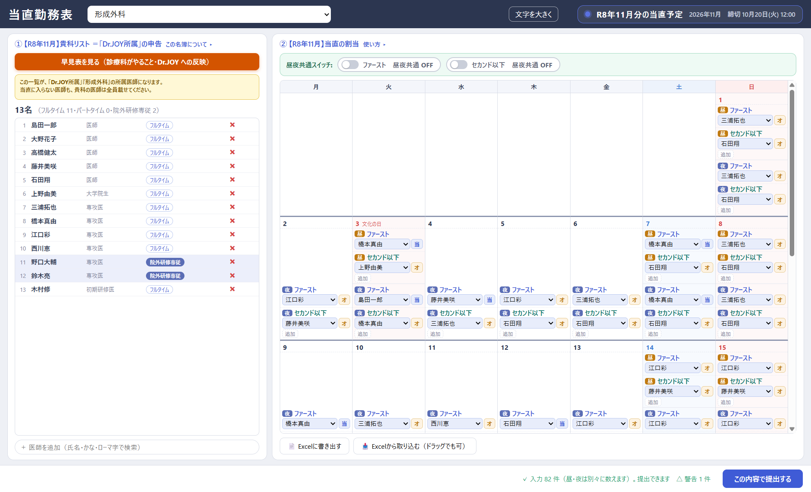
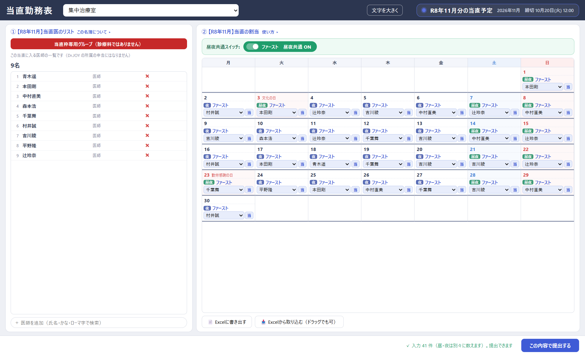
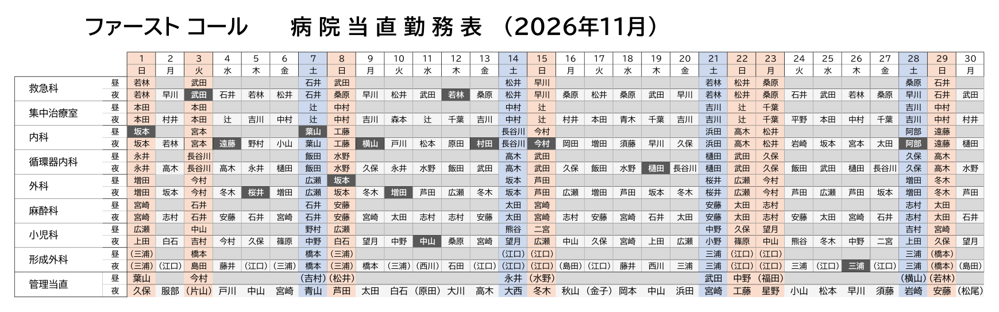

# 当直勤務表アプリと Dr.JOY 連携ツール

> [!CAUTION]
> ## ⚠ ご注意ください
>
> **このツールは、wooooooz が個人的に作成したものです。著作権は放棄しますので、改変・再配布はご自由に。**
>
> **Dr.JOY 社はツール開発に一切関与しておりません。**
>
> **ツールの使い方やトラブル相談などで、Dr.JOY 社に問い合わせないようにお願いいたします。**


医局の当直勤務表を各診療科がアプリで入力し、それを集めて当直表（Excel・PDF）と Dr.JOY の勤務予定へ流す仕組みです。
病院で毎月の運用に使っています。
同じ悩みを持つ病院で使っていただけるよう公開しています。

Dr.JOY の画面を自動で操作する部分は、Dr.JOY の画面が変わると動かなくなることがあります。
使う前に、自院の Dr.JOY の契約と利用規約を確かめてください。

## 何ができるか

| 段階 | 誰が | 何をする | 中身 |
|---|---|---|---|
| ① 入力 | 各診療科の庶務 | 月間カレンダーに当直・オンコールを入れて保存する | `app/`（Electron の入力アプリ） |
| ② 集約・点検 | 医局の事務 | 全科の提出状況と食い違いを確かめる | `tools/aggregate.py`・`tools/admin_gui.py` |
| ③ 当直表 | 自動 | 決裁用の当直表（Excel）と公開用の PDF を作る | `tools/duty_sheet.py`・`tools/dtx14_fill.py` |
| ④ 交代 | 各科・事務 | 月の途中の当直交代をアプリで申請し、事務が Excel で承認する | `tools/kotai_record.py` |
| ⑤ Dr.JOY へ | 自動 | 当直を Dr.JOY の勤務予定に一括で入れる・交代を反映する | `drjoy_import/`・`drjoy/` |

## 画面

診療科の入力画面です（左が科の医師の一覧、右が月のカレンダー。名前は架空です）。



集中治療室のような、当直のためだけの組（当直枠専用グループ）の画面です。



各科の入力を集めてできあがる当直表（ファーストコールの表）の見本です（名前と科の並びは架空です）。
毎日決まった時刻に Excel の当直表へ書き込み、PDF にして院内に公開します。
名前だけが当直、`(名前)` がオンコール、灰色の地が当番当直です。



## しくみ

全科の予定は、共有フォルダの1本の JSON（`当直予定表_YYYY年N月.json`）にまとめて持ちます。
アプリは起動のたびにそれを読み、保存のときは自分の科の分だけを差し替えます（ロックと版番号で同時編集を防ぎます）。

## フォルダ

```
app/            入力アプリ（Electron）。renderer/index.html が画面
  launcher/     起動を速くする小さな起動係（C#）
tools/          Python のツール一式（集約・月次の準備・当直表 xlsx・交代記録・毎日の反映）
data/           枠マスタ（frames.json）・祝日（holidays.csv）・科の対応（dept_map.json）の見本
drjoy/          Dr.JOY の画面操作（Playwright）。名簿の書き出し・勤務予定の取り込みなど
drjoy_import/   当直表から Dr.JOY の取り込み用 xlsx を作る
docs/           導入の手引き
```

## 必要なもの

- Windows 10/11（Excel を使う部分は Excel が要ります）
- Python 3.12 以降と `openpyxl`
- Node.js 20 以降（アプリのビルドと Dr.JOY の画面操作）
- 全員が読める共有フォルダ（アプリの置き場と予定表 JSON）
- Dr.JOY の管理者権限（名簿の書き出しと勤務予定の取り込み）

## そのままでは動きません

当直の枠の組み方、科の名前、共有フォルダの場所、メールの宛先は病院ごとに違います。
まず [docs/導入の手引き.md](docs/導入の手引き.md) を読み、自院の値に書き換えてください。

$\color{red}\textbf{AI エージェント（例えば、Claude Code など）にセッティングしてもらうことをおすすめします。}$

その場合は、まずこの README と [docs/導入の手引き.md](docs/導入の手引き.md) を AI に読ませてください。
そのうえで、自院の当直の組み方・科の名前・共有フォルダの場所・メールの宛先を伝えて、書き換えを頼んでください。

コードのコメントには、運用の中で決めた理由や、実際に起きた失敗が書いてあります。
そこに出てくる人の名前・ログインID・メールアドレスは、すべて架空のものです。

## 個人情報

名簿（職員の CSV）、当直表の Excel、PDF はリポジトリに入れません（`.gitignore` で除いています）。
自院で使うときも、名簿や当直表をコミットしないでください。

毎日の運用では、このツールは AI を使いません。名簿や当直表が AI のサービスに送られることはありません。
Dr.JOY への取り込みは、取り込み用の xlsx を作るスクリプトと、Dr.JOY の取り込み画面を操作するスクリプト（Playwright）で行います。
作った xlsx を、担当者が Dr.JOY の画面から手で取り込むこともできます。
AI を使うのは、自院向けに書き換える（セッティングする）ときだけです。そのときも、本物の名簿や当直表は AI に読ませないでください。

## ライセンス

著作権は放棄します（[CC0 1.0](LICENSE)）。
改変・再配布・商用利用を含め、許可も作者の表示も要りません。
無保証です。
使った結果について、作者は責任を負いません。
